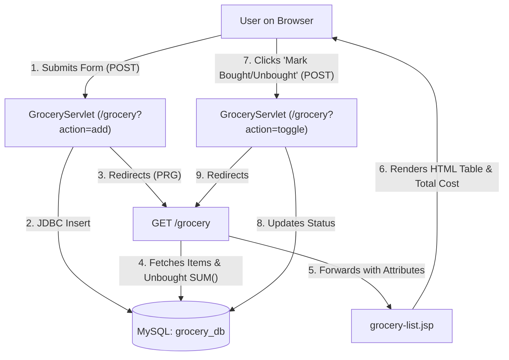

# 🛒 Grocery Management System

> **A lightweight, robust Java web application built with Jakarta Servlet 6.0, JSP, JDBC, and MySQL for tracking grocery items, managing shopping lists, and monitoring unbought expenses in real time.**

---

### 📌 Short GitHub Repository Description (Copy & Paste for GitHub "About")
```text
A Java EE / Jakarta Servlet & JSP web application for managing grocery lists and real-time expense calculation with MySQL and Tomcat 10.
```
*(Alternative one-liner: `🛒 Full-stack Java (Jakarta Servlet, JSP, JDBC, MySQL) grocery inventory and expense tracking web app.`)*

---

## 🌟 Overview

The **Grocery Management System** is an MVC-based Java web application designed to simplify grocery shopping and household inventory management. It allows users to log grocery items with quantities and unit prices, toggle purchase statuses with a single click, and dynamically calculate the total estimated expenditure for unbought items.

---

## 🚀 Key Features

- **Item Management**: Add items with name, quantity, and unit price in Indian Rupees (₹).
- **Status Toggling**: Instantly switch items between **Bought** and **Not Bought**.
- **Real-Time Cost Aggregation**: Automatically computes and highlights the cumulative price of remaining unbought items.
- **Two-Tier Validation**:
  - **Client-Side**: Fast JavaScript input validation ensuring positive integers for quantities and two-decimal formats for currency.
  - **Server-Side**: Strict data sanitization and bounds checking in the servlet layer.
- **Duplicate Submission Protection**: Implements the **Post/Redirect/Get (PRG)** design pattern to prevent accidental duplicate entries upon page refresh.
- **Responsive UI**: Clean, mobile-friendly interface styled with modern CSS3.

---

## 🛠️ Tech Stack

| Component | Technology | Version |
| :--- | :--- | :--- |
| **Language** | Java | 21 (LTS) |
| **Web Framework** | Jakarta Servlet API | 6.0.0 |
| **View Layer** | JSP (JavaServer Pages), HTML5, CSS3, JavaScript | Jakarta EE 10 |
| **Database** | MySQL Server | 8.0+ |
| **Database Driver** | MySQL Connector/J | 9.4.0 |
| **Application Server** | Apache Tomcat | 10.1+ (Jakarta EE 10 compatible) |
| **Build & Dependency Management** | Apache Maven | 3.8+ |

---

## 📂 Project Architecture & Directory Structure

This application adheres to standard MVC (Model-View-Controller) architecture:
- **Model**: [Grocery.java](file:///c:/Users/DELL/Desktop/javacase/src/main/java/com/grocery/Grocery.java)
- **Controller**: [GroceryServlet.java](file:///c:/Users/DELL/Desktop/javacase/src/main/java/com/grocery/GroceryServlet.java)
- **View**: [index.jsp](file:///c:/Users/DELL/Desktop/javacase/src/main/webapp/index.jsp), [grocery-list.jsp](file:///c:/Users/DELL/Desktop/javacase/src/main/webapp/grocery-list.jsp), [style.css](file:///c:/Users/DELL/Desktop/javacase/src/main/webapp/style.css)
- **Database Helper**: [DBConnection.java](file:///c:/Users/DELL/Desktop/javacase/src/main/java/com/grocery/DBConnection.java)

```text
javacase/
├── pom.xml                                  # Maven dependencies and build configuration
├── README.md                                # Project documentation
└── src/
    └── main/
        ├── java/
        │   └── com/
        │       └── grocery/
        │           ├── DBConnection.java    # MySQL JDBC connection manager
        │           ├── Grocery.java         # Data model representing grocery items
        │           └── GroceryServlet.java  # Controller handling GET and POST actions
        └── webapp/
            ├── WEB-INF/
            │   └── web.xml                  # Servlet container deployment descriptor
            ├── grocery-list.jsp             # Tabular list & expense overview view
            ├── index.jsp                    # Add grocery item form
            └── style.css                    # Modern UI styles & responsive layout
```

---

## 🗄️ Database Setup

1. Open your MySQL client (MySQL Workbench, phpMyAdmin, or command-line terminal).
2. Execute the following SQL script to create the database and table:

```sql
-- 1. Create database
CREATE DATABASE IF NOT EXISTS grocery_db;
USE grocery_db;

-- 2. Create grocery table
CREATE TABLE IF NOT EXISTS grocery (
    id INT AUTO_INCREMENT PRIMARY KEY,
    item VARCHAR(100) NOT NULL,
    qty INT NOT NULL,
    price DECIMAL(10, 2) NOT NULL,
    bought BOOLEAN NOT NULL DEFAULT FALSE
);

-- 3. (Optional) Insert sample records
INSERT INTO grocery (item, qty, price, bought) VALUES
('Apples', 2, 80.00, FALSE),
('Milk (1L)', 1, 30.00, TRUE),
('Whole Wheat Bread', 1, 45.50, FALSE);
```

---

## ⚙️ Configuration

Ensure your database connection details in [`src/main/java/com/grocery/DBConnection.java`](file:///c:/Users/DELL/Desktop/javacase/src/main/java/com/grocery/DBConnection.java) match your local MySQL configuration:

```java
private static final String URL = "jdbc:mysql://localhost:3307/grocery_db"; // Adjust port (e.g., 3306 or 3307)
private static final String USER = "root";                                 // Your MySQL username
private static final String PASSWORD = "your_mysql_password";             // Your MySQL password
```

> **Note**: Update the port (`3306` or `3307`) and credentials according to your local MySQL server setup.

---

## 📦 Build and Deployment

### Prerequisites
- **JDK 21** or later installed and configured on your `PATH`.
- **Apache Maven 3.8+** installed.
- **Apache Tomcat 10.1+** installed (Tomcat 10.1+ supports `jakarta.servlet` namespace).

### 1. Build the WAR File
Open your terminal in the project root directory and run:

```bash
mvn clean package
```

Upon a successful build, the deployable `GroceryManagement.war` archive will be generated under the `target/` directory:
```text
target/GroceryManagement.war
```

### 2. Deploy to Apache Tomcat
1. Copy `target/GroceryManagement.war` into the `webapps/` folder of your Apache Tomcat 10.1+ installation directory:
   ```bash
   cp target/GroceryManagement.war <TOMCAT_HOME>/webapps/
   ```
2. Start the Tomcat server:
   - **Windows**: `<TOMCAT_HOME>\bin\startup.bat`
   - **Linux/macOS**: `<TOMCAT_HOME>/bin/startup.sh`
3. Tomcat will automatically extract and deploy the WAR file.

---

## 🌐 Application Access & Endpoints

Open your web browser and navigate to:

| Page / Endpoint | URL | Description |
| :--- | :--- | :--- |
| **Add Grocery Page** | `http://localhost:8080/GroceryManagement/` | Entry form to submit new grocery items |
| **Grocery List & Total** | `http://localhost:8080/GroceryManagement/grocery` | View full inventory, toggle bought status, check total cost |

---

## 🔄 Application Workflow



---

## 🛡️ License

This project is licensed under the [MIT License](LICENSE) - feel free to use and adapt it for learning or personal projects.
